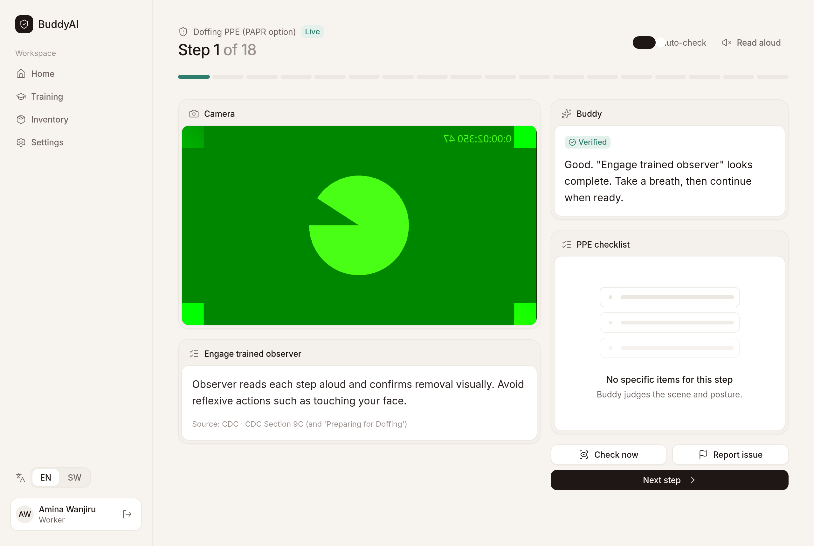
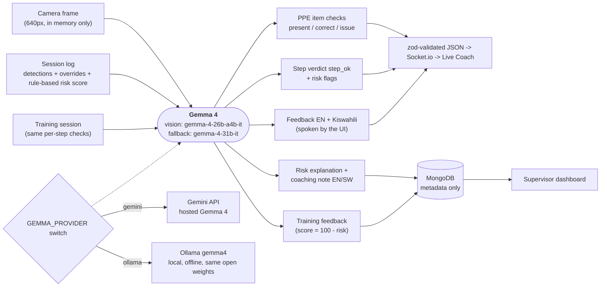
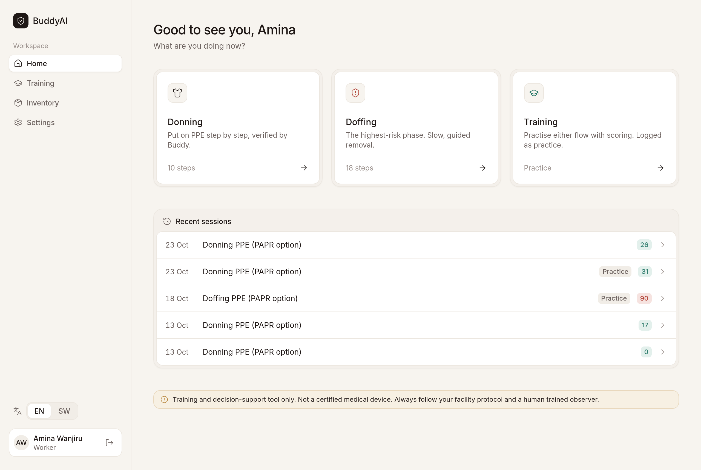
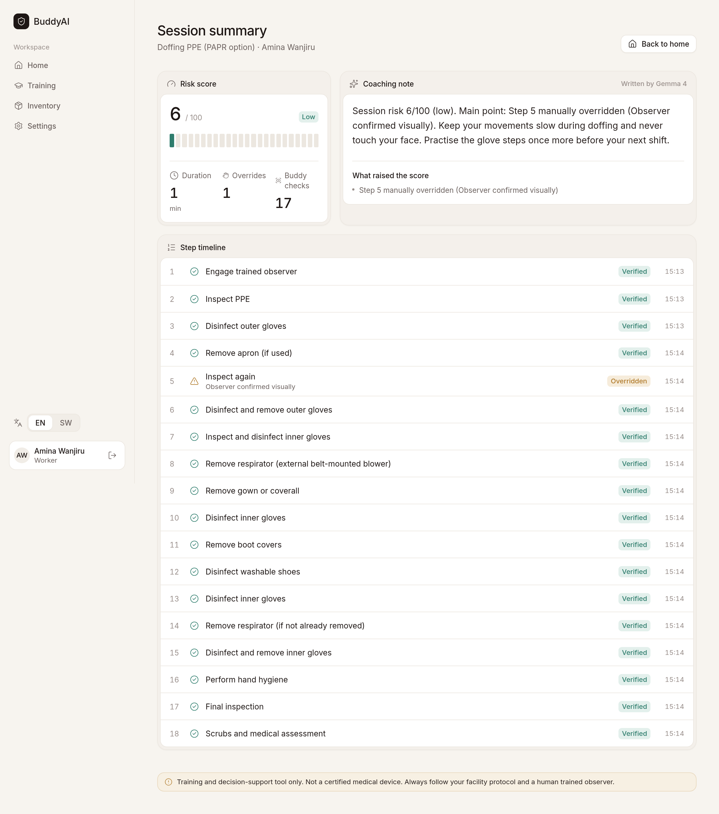
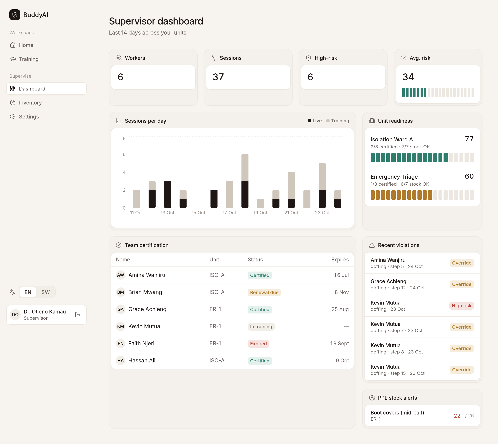
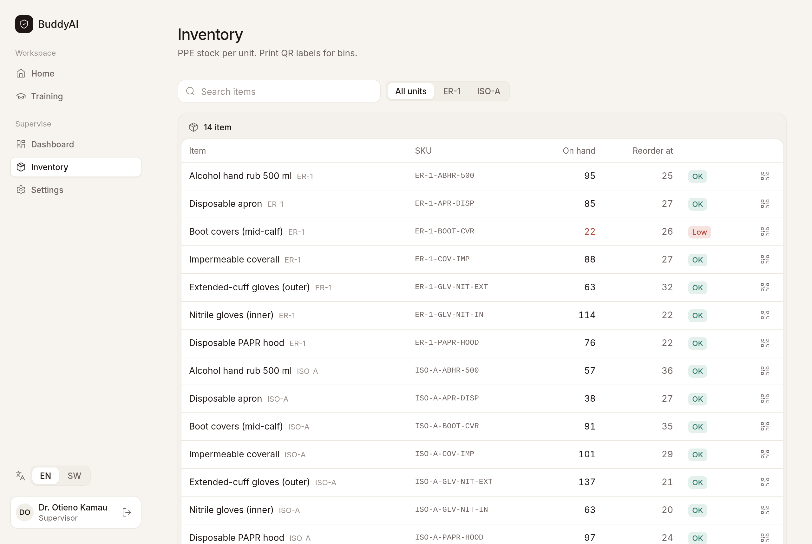
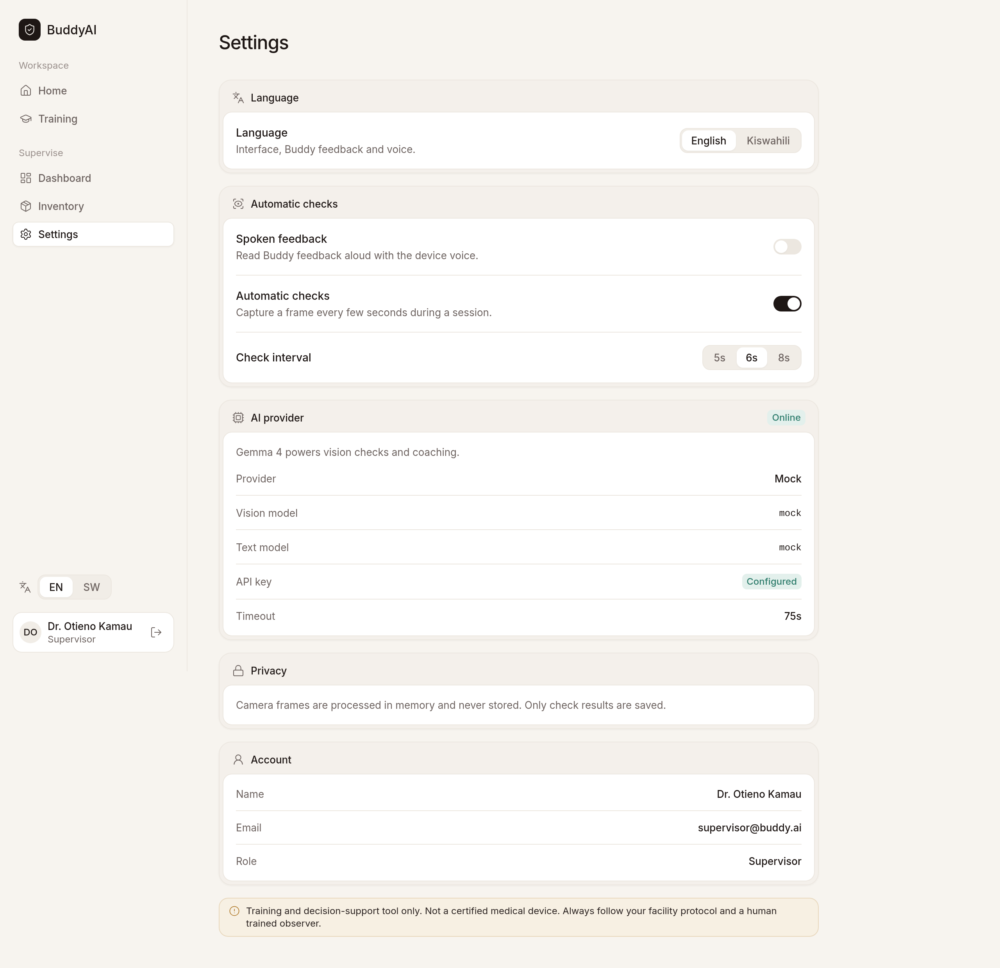

<div align="center">


# BuddyAI

**A Gemma 4 buddy that watches Ebola PPE donning and doffing and speaks up, in English and Kiswahili.**


> **Live demo:** a public Hack Day URL could not be opened from the build machine (its network blocks Cloudflare tunnel traffic). Run it locally in one command (see Quick start) or deploy with [DEPLOY.md](DEPLOY.md). Demo logins: `worker@buddy.ai` / `buddy-demo-2026`, `supervisor@buddy.ai` / `buddy-demo-2026`.

[Demo](#quick-start) · [Video](#) · [Pitch](PITCH.md) · [Docs](#how-it-works)



</div>

> [!IMPORTANT]
> BuddyAI is a **training and decision-support tool. It is not a medical device.** It does not replace a trained observer, your facility's protocol or CDC/WHO guidance. Always defer to your Infection Prevention and Control (IPC) lead.

---

## What it does

Doffing is when healthcare workers get infected. CDC guidance calls for a trained observer at every PPE change, but in a busy isolation unit there often isn't one. BuddyAI turns a tablet into a second pair of eyes. Every 5–8 seconds, or when you tap **Check now**, it sends one camera frame to Gemma 4. Gemma checks the frame against the current CDC step, then the app shows and reads out short feedback in English or Kiswahili. Supervisors see risk, violations, certification and PPE stock for each unit.

| Feature | What it does |
|---|---|
| **Live Coach** | Step-by-step CDC donning/doffing with a vision check per step. You can't continue until the step passes or you log an override with a reason. |
| **Bilingual voice** | Every prompt and Gemma reply is in EN + SW, with optional text-to-speech. |
| **Training mode** | Practice runs that get a training score and certification tracking. |
| **Session summary** | A deterministic risk score (overrides, failed checks, flags), plus a coaching note written by Gemma. |
| **Supervisor dashboard** | 14-day activity, unit readiness, recent violations, team certification, stock alerts. |
| **Inventory + QR** | PPE stock per unit with printable QR labels. |
| **Three AI providers** | Gemini API (Gemma 4 hosted), Ollama (on-device Gemma 4) or a deterministic mock. |
| **Privacy first** | Frames are processed in memory and never stored. Only metadata is kept. |

---

## How it works

**Gemma 4 is the core model behind every AI capability in BuddyAI.** Nothing else interprets frames or writes feedback; the risk score is a transparent rule set, and Gemma 4 turns it into the coaching note.



### Why Gemma 4

- **Open weights, Apache 2.0**: the same model runs offline on hospital hardware through Ollama, with no frames leaving the ward.
- **Multimodal in one model**: vision and language together, so a single call both inspects the PPE in the frame and writes the guidance.
- **Bilingual output**: every check and coaching note comes back in English and Kiswahili (`feedback_en` / `feedback_sw`, `coaching_en` / `coaching_sw`).
- **Structured JSON**: Gemma returns a fixed schema that is validated with zod (one re-ask on bad JSON), so the app can enforce the protocol: you cannot advance until `step_ok` is true or you log an override.

### Every AI feature and the Gemma 4 call behind it

| Feature | Gemma 4 call (server/src/services/gemma.js) | Model |
|---|---|---|
| Live PPE item checks (present / correct / issue) | `checkFrame()` via `POST /api/sessions/:id/check` | `gemma-4-26b-a4b-it`, fallback `gemma-4-31b-it` (Ollama: `gemma4`) |
| Step verdict (`step_ok`) and risk flags | `checkFrame()` (same call) | same as above |
| EN + Kiswahili spoken feedback | `checkFrame()` (`feedback_en`, `feedback_sw`) | same as above |
| Risk explanation and coaching note | `coachingNote()` at session finish | `gemma-4-26b-a4b-it`, fallback `gemma-4-31b-it` (Ollama: `gemma4`) |
| Training mode feedback | `checkFrame()` per step + `coachingNote()`; score = 100 - rule-based risk | same as above |

Demo mode (toggle in Settings) swaps in clearly labelled scripted responses (`provider: "demo"`) for a flaky network; it never pretends to be Gemma.

Gemma returns a fixed shape for each check: `{ items:[{name,present,correct,issue,confidence}], step_ok, feedback_en, feedback_sw, risk_flags }`. Every call has a timeout (45 s by default), retry with exponential backoff on 408/429/5xx, model fallback and per-call timing. While a call runs, the UI shows *Buddy is checking…*, and you can always continue by hand with a logged override.

**Real Gemma 4 result.** We sent one call to the Gemini API with a [Wikimedia Commons Ebola PPE photo](https://commons.wikimedia.org/wiki/File:Checking_Personal_Protective_Equipment_(PPE)_in_the_fight_against_Ebola_(15650272810).jpg) (CC BY 2.0, DFID):
- `gemma-4-31b-it` returned a 500, so the call fell back to `gemma-4-26b-a4b-it`. The total was **62.7 s over 4 attempts**.
- Gemma found the coverall present and correct (confidence 0.9) and the outer gloves *not visible*, so it set `step_ok:false`.
- Feedback: "The coverall appears clean and intact. Please ensure you also inspect your outer gloves…", with a Kiswahili version.

A second check through the full app API (`POST /api/sessions/:id/check`) succeeded on `gemma-4-31b-it` in **44.0 s (2 attempts)**.

### Tech stack

| Layer | Tools |
|---|---|
| Client | React 18, Vite 5, Tailwind 3, React Query 5, Zustand, React Router 6, vite-plugin-pwa, Recharts, Lucide, qrcode |
| Server | Node 20, Express 5, Mongoose 9, Socket.io, zod 4, JWT + bcrypt, multer (memory) |
| AI | Gemma 4 via `@google/genai` or Ollama `/api/chat` |
| Data | MongoDB, with a `mongodb-memory-server` fallback for zero-setup runs |
| Tests | Vitest, Supertest, Testing Library |

### Models

[Gemma 4](https://opensource.googleblog.com/2026/03/gemma-4-expanding-the-gemmaverse-with-apache-20.html) is released under **Apache 2.0**:
- Vision (live checks): `gemma-4-26b-a4b-it`, fallback `gemma-4-31b-it`
- Text and coaching: `gemma-4-26b-a4b-it`, fallback `gemma-4-31b-it`
- Local: `gemma4` (e4b) on Ollama

---

## Screenshots

| Home | Live Coach |
|---|---|
|  |  |
| **Session summary** | **Supervisor dashboard** |
|  |  |
| **Inventory** | **Settings** |
|  |  |

---

## Quick start

```bash
git clone https://github.com/Chrisleo-16/buddyai.git && cd buddyai
npm install
cp server/.env.example server/.env    # then fill in values locally; never commit it
npm run dev                           # API :4000, app http://localhost:5173
```

Demo logins (password `buddy-demo-2026`): `worker@buddy.ai`, `supervisor@buddy.ai`. With `MONGO_URI` empty the server starts an in-memory MongoDB and seeds it.

```bash
# Mock mode: no key, deterministic
GEMMA_PROVIDER=mock npm run dev

# Gemini API (hosted Gemma 4)
GEMMA_PROVIDER=gemini GEMINI_API_KEY=... npm run dev

# Ollama (on-device)
ollama pull gemma4
GEMMA_PROVIDER=ollama OLLAMA_HOST=http://localhost:11434 OLLAMA_MODEL=gemma4 npm run dev

# Docker: mongo + server + client on http://localhost:8080
docker compose up --build
```

**Ollama notes.** Images go in the message's `images` field with `format:"json"`. Gemma 4 thinking tags are stripped before parsing. Larger tags (`gemma4:26b`, `gemma4:31b`) are more accurate. `e2b`/`e4b` fit edge devices but take longer per frame on a CPU, so raise `GEMMA_TIMEOUT_MS` there.

| Variable | Purpose |
|---|---|
| `PORT` | API port (4000) |
| `MONGO_URI` | MongoDB URI; empty = in-memory |
| `JWT_SECRET` | Token signing secret |
| `CLIENT_ORIGIN` | CORS origin |
| `GEMMA_PROVIDER` | `gemini` \| `ollama` \| `mock` |
| `GEMINI_API_KEY` | Gemini API key |
| `GEMMA_VISION_MODEL` / `GEMMA_TEXT_MODEL` | Model overrides |
| `GEMMA_TIMEOUT_MS` / `GEMMA_RETRIES` | Per-call timeout and retries |
| `GEMMA_LIVE_THINKING` / `GEMMA_LIVE_MAX_TOKENS` | Live checks run with thinking `minimal` (off) and a 320-token cap |
| `DEMO_MODE` | `true` = scripted ~1.5 s responses, labelled "Demo mode" in the UI (also a toggle in Settings) |
| `OLLAMA_HOST` / `OLLAMA_MODEL` | Ollama settings |
| `AT_SMS_ENABLED`, `AT_USERNAME`, `AT_API_KEY`, `AT_SUPERVISOR_PHONE`, `AT_RISK_THRESHOLD` | Optional Africa's Talking alerts |

---

## Project structure

```
buddyai/
├── client/                 React PWA
│   └── src/
│       ├── pages/          Login, Home, LiveCoach, Summary, Training, Dashboard, Inventory, Settings
│       ├── components/     ui.jsx (design system), Layout, Checklist
│       ├── i18n/           EN + SW strings
│       └── lib/            api, camera + speech, socket
├── server/
│   └── src/
│       ├── data/           protocols.json (CDC steps + source URLs)
│       ├── services/       gemma.js, mockGemma.js, gemmaSchema.js, prompts.js, risk.js, sms.js
│       ├── routes/         auth, protocols, sessions, dashboard, inventory
│       └── models/         User, Protocol, Session, InventoryItem, Unit
├── docs/                   logo, screenshots, test image
├── docker-compose.yml
└── PITCH.md
```

## Tests

```bash
npm test   # server: 13 tests (API, auth/roles, Gemma JSON parsing, risk). client: 5 tests (checklist, meter, i18n)
```

---

## Protocol sources

The steps are taken from CDC guidance. No steps were invented, and every step links to its source.
- [CDC: PPE for clinically unstable patients (VHF), donning and doffing](https://www.cdc.gov/viral-hemorrhagic-fevers/hcp/guidance/ppe-clinically-unstable.html)
- [CDC: VHF PPE guidance index](https://www.cdc.gov/viral-hemorrhagic-fevers/hcp/guidance/index.html) · [CDC PPE FAQs](https://www.cdc.gov/viral-hemorrhagic-fevers/hcp/guidance/ppe-faqs.html)
- [WHO: Personal protective equipment for use in a filovirus disease outbreak](https://www.who.int/publications/i/item/9789241549721)

## Roadmap

- [ ] On-device pre-filter with YOLO / MediaPipe so Gemma only sees frames that change
- [ ] Ollama + Gemma 4 e2b on a Raspberry Pi 5 for clinics with no connectivity
- [ ] MoH / county IPC dashboards and DHIS2 export
- [ ] Kenya Data Protection Act 2019 compliance review and a DPIA
- [ ] Glove-hygiene step timers and audio-only mode

## Contributing

Pull requests are welcome, especially Hacktoberfest ones. See
[CONTRIBUTIONS.md](CONTRIBUTIONS.md) for the development setup, testing
commands, contribution workflow, and project roadmap. Good first issues:
- More languages (Luganda, French, Lingala)
- New protocol variants, with a source URL for every step
- Accessibility fixes

Run `npm test` before you open a PR, and never commit `.env*` files.

## License

[Apache 2.0](LICENSE) © 2026 Chrisben Evans Leo and contributors. Built for MLH Hacktoberfest Hack Day Nairobi.

## Live-check latency

Live checks use `gemma-4-26b-a4b-it` with thinking set to `minimal`, a compact per-step prompt and JSON shape (`{i,s,en,sw,f}`, expanded server-side), and `maxOutputTokens: 320`. The client sends 640px JPEG frames at quality 0.7, skips auto-checks when the frame barely changed, runs one check at a time per session, and spaces auto-checks by the measured latency. After 20 s the coach keeps the last result on screen and the check finishes in the background. Measure it with `node server/scripts/bench.js --img docs/test-images/ppe-check.jpg --model gemma-4-26b-a4b-it --prompt compact --thinking minimal --max 320 --runs 5`.
